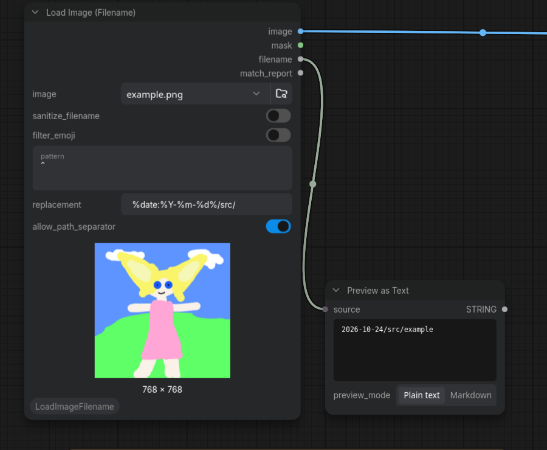

# ComfyUI Load Image (Filename)

It is ComfyUI's built-in `Load Image` node plus loaded file's
name without its extension (`photo.png` -> `photo`). Also supports filename manipulation with regex.


## Installation

Install through ComfyUI Manager, or clone into `custom_nodes`:

```bash
cd ComfyUI/custom_nodes
git clone https://github.com/yszhangit/ComfyUI-LoadImageFilename
```

No dependencies. Restart ComfyUI afterwards.

## Outputs

| Name | Type | Description |
| --- | --- | --- |
| `image` | IMAGE | The loaded image tensor. |
| `mask` | MASK | The image mask, same as the built-in node. |
| `filename` | STRING | File name without extension. |
| `match_report` | STRING | Regex-match report (`SOURCE`/`PATTERN`/`MATCHED`/`RESULT`); wire to a Preview Text node. |

## Typical use case: feeding Save Image

Use the input file's name as part of the output file's name.

1. Add the node and pick an image.
2. Connect `filename` into `Save Image`'s `filename_prefix` (directly, or via a
   text-concat node to add your own prefix/postfix).
3. The saved file is named after the sanitized `filename` output.

## Toggles

Three independent boolean inputs control the `filename` output. Each is part of
`IS_CHANGED`, so flipping a toggle re-runs the node and refreshes the output.

### `sanitize_filename` (on by default)

Removes everything that must not appear in a file name or directory component:

- Control characters: newline `\n`, carriage return, tab, NUL, DEL, and Unicode
  control/format characters (zero-width joins, soft hyphen, …).
- Path separators `/` and `\`, and the reserved set `: * ? " < > |`.
- Leading/trailing dots and spaces (hidden-file leading dots, the trailing
  `.`/space Windows rejects).

Interior spaces and non-ASCII letters (Chinese, accented letters, …) are kept —
only unsafe characters are dropped. Turning this off returns the raw name.

### `filter_emoji` (off by default)

Removes emoji and emoji joiners: the pictograph / emoticon / symbol blocks, flag
regional indicators, variation selectors, the zero-width joiner, combining
keycap, and common symbol singles (`© ® ™ ✅ ❌ ⭐` …). Independent of sanitize —
enable it on top of sanitize to drop emoji too, or alone to strip emoji while
leaving control and reserved characters untouched.

### `allow_path_separator` (off by default)

Only applies when `sanitize_filename` is on. Keeps `/` so a regex `replacement`
can build a **subfolder** for `Save Image` — `Save Image` reads `/` as a subfolder
on Windows and Linux alike (use `/`, not `\`). Everything else is still stripped:
`\ : * ? " < > |`, control characters, and any `.` / `..` / leading-slash segment,
so a name cannot traverse outside `output/` (ComfyUI's own output-containment
check is a final backstop). Windows reserved names like `CON` are moot —
`Save Image` appends `_00001_`, making `CON_00001_.png`.

## Regex manipulation

`pattern` + `replacement` run `re.sub(pattern, replacement, filename)` on the
name, **before** the emoji and sanitize steps. Leave `pattern` empty for the
plain behavior.

- **Strip a counter** — `pattern = _+\d+_*` with an empty replacement turns
  `ComfyUI_00001_` into `ComfyUI` and `slot_001` into `slot`.
- **Rename fully** — `pattern = ^.*$`, replacement = the new name.
- **Groups** — `replacement` supports captures: `pattern = (\d+)` and
  `replacement = [\1]` brackets the digits.

Sanitize runs last, so a replacement can't inject a `/` into the saved name. An
invalid pattern (e.g. `(`) reports a clear node error; a pattern that matches
nothing leaves the name unchanged.

#### Date in the filename

The node expands date tokens in its `filename` output **before** sanitize, so a
wired prefix carries a real date. (`%date:…%` is a frontend-widget feature and
the server only expands `%year% %month% %day%` in widget strings — a linked
filename bypasses both, so the node does it itself.)

- `%date:%Y-%m-%d%` (strftime) → `2026-10-24`
- `%year% %month% %day%` → `2026`, `10`, `24`

Example: `pattern = ^`, `replacement = qwen_edit/%date:%Y-%m-%d%/`, with
`allow_path_separator` on → `qwen_edit/2026-10-24/photo`. Time tokens
(`%hour% %minute% %second%`) are intentionally **not** expanded — for a timestamp
use `%date:%Y-%m-%d-%H%M%S%`. `Save Image` still appends its `_00001_` counter, so
you don't need a timestamp for unique names — date is enough.



## Common patterns

Python `re` syntax. The result below is the regex step; the `sanitize_filename`
toggle then strips control/path/reserved characters (so a replacement can't
inject a `/`), and `filter_emoji` (if on) removes emoji.

| Source name | `pattern` | `replacement` | Result |
| --- | --- | --- | --- |
| `ComfyUI_00001_` | `_+\d+_*` | *(empty)* | `ComfyUI` |
| `slot_001` | `_+\d+_*` | *(empty)* | `slot` |
| `DSC_0420` | `_?\d+$` | *(empty)* | `DSC` |
| `001_photo` | `^\d+_?` | *(empty)* | `photo` |
| `2024-01-15_photo` | `^\d{4}-\d{2}-\d{2}_?` | *(empty)* | `photo` |
| `slot_001_v2` | `_.*$` | *(empty)* | `slot` |
| `a_b_c` | `^.*_` | *(empty)* | `c` |
| `photo copy 2` | ` copy \d+$` | *(empty)* | `photo` |
| `my cool pic` | `\s+` | `_` | `my_cool_pic` |
| `a___b` | `_{2,}` | `_` | `a_b` |
| `img00042png` | `[^0-9]+` | *(empty)* | `00042` |
| `verylongfilename123456` | `^(.{12}).*$` | `\1` | `verylongfile` |
| *(any name)* | `^.*$` | `myname` | `myname` |
| `photo` | `^` | `myapp_` | `myapp_photo` (prepend) |
| `photo` | `$` | `-2024-05-01` | `photo-2024-05-01` (append) |
| `photo` | `^.*$` | `pre-\g<0>-suf` | `pre-photo-suf` (wrap) |

- **Strip a counter** — `_+\d+_*` (trailing), `^\d+_?` (leading). The `$`/`^`
  anchors keep it from eating a middle `_1_`.
- **Rename fully** — `^.*$` + the new name in `replacement`.
- **Prepend / append / wrap** — pattern `^` prepends to `replacement`; pattern
  `$` appends. Wrap both with `^.*$` and `replacement = pre-\g<0>-suf`. The whole
  match is `\g<0>` — **not** `\0` (which is a NUL byte).
- **Keep first N chars** — `^(.{N}).*$` with `replacement = \1`.
- **Groups** — `replacement` supports `\1`, `\2`, … referencing capture groups.


## Inspired by

[thalismind/ComfyUI-LoadImageWithFilename](https://github.com/thalismind/ComfyUI-LoadImageWithFilename),
which outputs the file name alongside folder loading and a file-name driven
`Save Image`. This pack is an independent minimal implementation: it subclasses
ComfyUI's own `LoadImage` rather than copying the decode and save code.

## License

GPL-3.0, matching ComfyUI itself. See [LICENSE](LICENSE).

